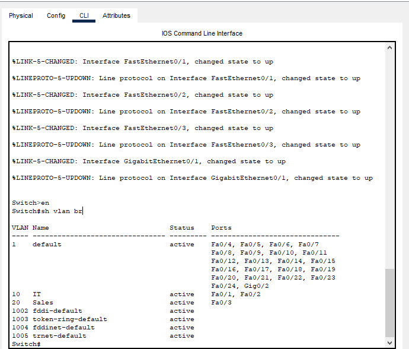
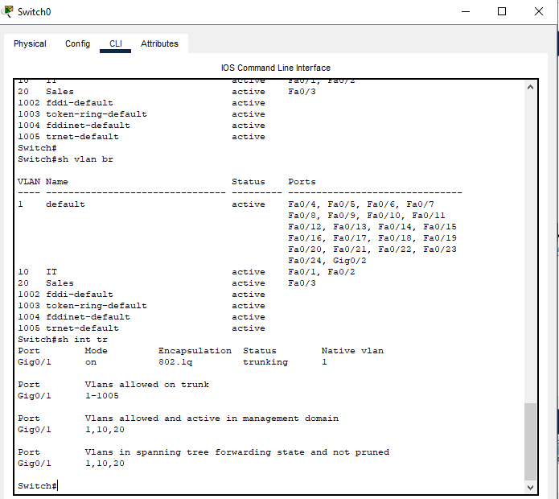
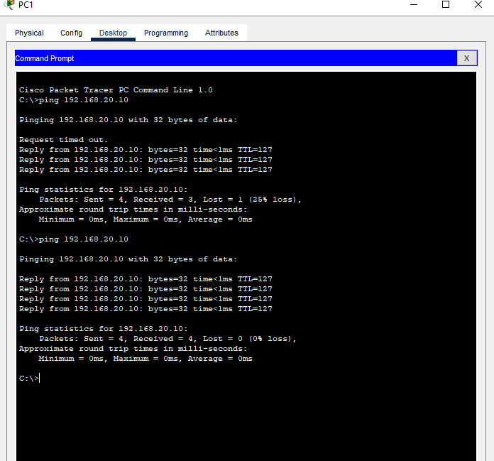

# Cisco Routing and Switching Lab

## Project Overview

Configured a Cisco Packet Tracer network using VLANs, 802.1Q trunking, and router-on-a-stick inter-VLAN routing.

The objective was to separate IT and Sales into different VLANs while allowing communication between them through a Cisco router.

## Equipment

- Cisco 2911 Router
- Cisco 2960 Switch
- Three PCs
- Cisco Packet Tracer

## IP Addressing

| Device | VLAN | IP Address | Default Gateway |
|---|---|---|---|
| PC1 | 10 - IT | 192.168.10.10/24 | 192.168.10.1 |
| PC2 | 10 - IT | 192.168.10.20/24 | 192.168.10.1 |
| PC3 | 20 - Sales | 192.168.20.10/24 | 192.168.20.1 |

## Switch Configuration

Created VLAN 10 (IT) and VLAN 20 (Sales).

Assigned switch ports:

- Fa0/1 and Fa0/2 to VLAN 10
- Fa0/3 to VLAN 20
- Gi0/1 as an 802.1Q trunk

Verified VLAN membership using `show vlan brief` and trunk operation using `show interfaces trunk`.

## Router Configuration

Configured router-on-a-stick using the following subinterfaces:

- Gi0/0.10 — 192.168.10.1/24, VLAN 10
- Gi0/0.20 — 192.168.20.1/24, VLAN 20

Verified the connected networks using `show ip route`.

## Connectivity Testing

Tested connectivity from PC1 (192.168.10.10) in VLAN 10 to PC3 (192.168.20.10) in VLAN 20.

The initial ping returned three replies out of four. A second test succeeded with **four replies and 0% packet loss**.

This confirmed successful inter-VLAN communication.

## Screenshots

### VLAN Configuration

### 802.1Q Trunk Verification

### Inter-VLAN Ping Test

### Additional Lab Screenshot

## Skills Demonstrated

- Cisco IOS command-line configuration
- VLAN creation and port assignments
- 802.1Q trunking
- Router-on-a-stick configuration
- IPv4 addressing and default gateways
- Inter-VLAN routing
- Ping testing and network troubleshooting

## Packet Tracer Project

[Download the Cisco Packet Tracer lab](Cisco-Routing-Switching-Lab.pkt)

## Future Improvements

Expand the topology to include a second router, static routing, and OSPF dynamic routing.
