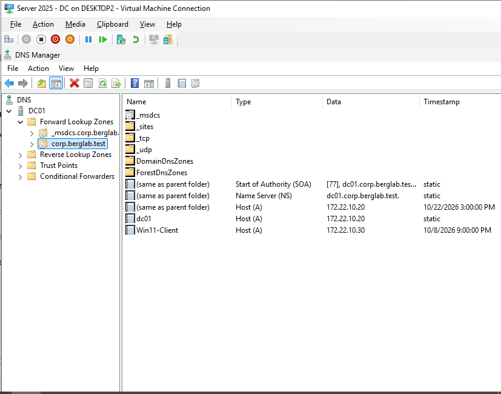

# Networking, DNS, and DHCP

## Project Overview
Configured and troubleshot networking services in a Windows Server 2025 lab environment using a domain-joined Windows 11 client.

## Skills Demonstrated
- Tested DNS name resolution and domain connectivity.
- Worked with DHCP and IP address configuration.
- Used Windows networking commands to diagnose connectivity problems.
- Troubleshot client-to-server communication.
- Verified network settings in a Hyper-V virtual environment.

## Lab Environment
- Windows Server 2025
- Windows 11 Domain-Joined Client
- Microsoft Hyper-V

## Documentation
I will add detailed lab notes, troubleshooting examples, and screenshots as this portfolio develops.

## DNS Configuration Screenshot

Using DNS Manager on Windows Server 2025, I examined the `corp.berglab.test` forward lookup zone on domain controller `DC01`.

The screenshot shows the following DNS Host (A) records:

- `dc01` — `172.22.10.20`
- `Win11-Client` — `172.22.10.30`

These records associate computer names with IPv4 addresses on my lab network.

