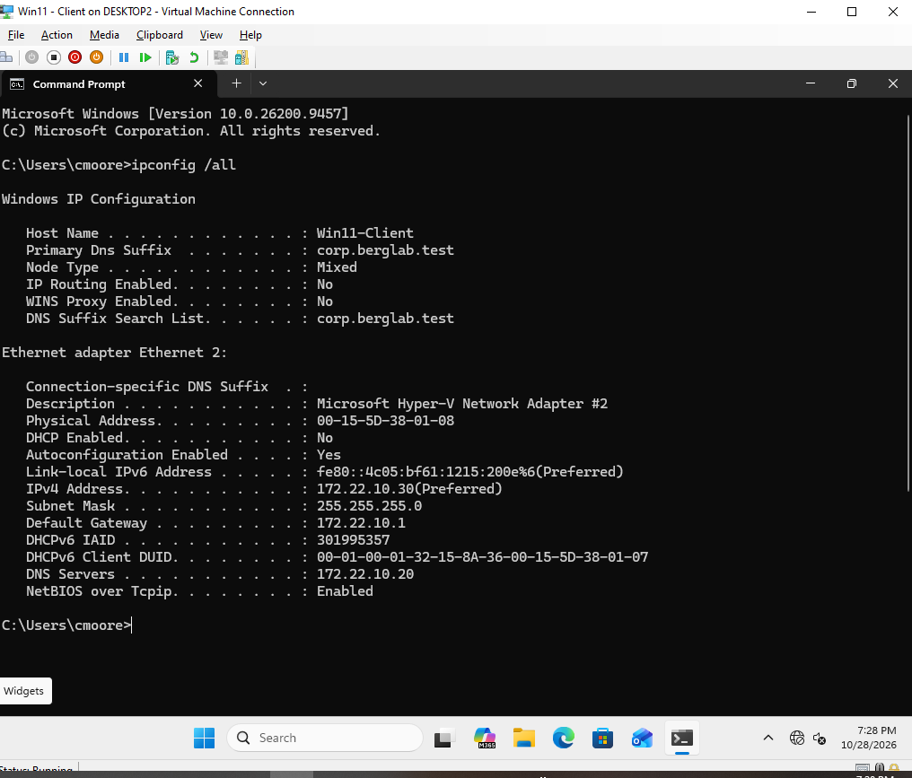

# Networking, DNS, and DHCP

## Project Overview
Configured and troubleshot networking services in a Windows Server 2025 lab environment using a domain-joined Windows 11 client.

## Skills Demonstrated
- Tested DNS name resolution and domain connectivity.
- Worked with DHCP and IP address configuration.
- Used Windows networking commands to diagnose connectivity problems.
- Troubleshot client-to-server communication.
- Verified network settings in a Hyper-V virtual environment.

## Lab Environment
- Windows Server 2025
- Windows 11 Domain-Joined Client
- Microsoft Hyper-V

## Documentation
I will add detailed lab notes, troubleshooting examples, and screenshots as this portfolio develops.

## DNS Configuration Screenshot

Using DNS Manager on Windows Server 2025, I examined the `corp.berglab.test` forward lookup zone on domain controller `DC01`.

The screenshot shows the following DNS Host (A) records:

- `dc01` — `172.22.10.20`
- `Win11-Client` — `172.22.10.30`

These records associate computer names with IPv4 addresses on my lab network.

## 💻 Client Workstation Configuration & Verification

To verify the correct operational environment of the Active Directory Domain Services (AD DS) and local DNS configurations, a virtualized Windows 11 client workstation was deployed and joined to the private domain environment. 

### ⚙️ Technical Environment Details
*   **Target Domain:** `corp.berglab.test`
*   **Virtualization Host:** Microsoft Hyper-V Manager
*   **Client Host Name:** `Win11-Client`
*   **Current User Profile:** `cmoore` (Domain Authenticated Account)

### 🌐 Network Interface Verification
The screenshot below documents the output of the network configuration tool (`ipconfig /all`) executed from the elevated Command Prompt on the client workstation. This verifies successful end-to-end routing and core network service provisioning:

### 🔍 Key Technical Takeaways from the Verification Output:
1.  **Domain Domain Name System (DNS) Alignment:** The interface has successfully updated its **Primary DNS Suffix** and **DNS Suffix Search List** to match the target corporate domain: `corp.berglab.test`.
2.  **Explicit Static/Leased IP Allocation:** The adapter is communicating via an active IPv4 address layout (`172.22.10.30`) configured on the local subnet (`255.255.255.0`), allowing structured access patterns.
3.  **Active Directory Name Resolution Routing:** The system is routing internal
